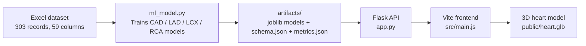

# CardioVision AI

CardioVision AI is a local educational prototype that demonstrates cardiovascular risk prediction, vessel-level outputs, and a 3D heart viewer built with Flask and Three.js.

## Project goal

This repository is designed for research and learning only. It does not replace clinical diagnosis or medical decision-making.

## Architecture



## Setup

### Terminal 1: Python backend

```bash
cd "/Users/udhaymishra/Desktop/iit mandi /cardiac-risk-project/heart-viewer"
python3 -m venv .venv
source .venv/bin/activate
python -m pip install --upgrade pip
pip install pandas openpyxl scikit-learn flask flask-cors joblib
python3 ml_model.py
python3 app.py
```

### Terminal 2: Frontend

```bash
cd "/Users/udhaymishra/Desktop/iit mandi /cardiac-risk-project/heart-viewer"
npm install
npm run dev -- --host 127.0.0.1 --port 5173
```

## API endpoints

- GET http://127.0.0.1:5000/api/health
- GET http://127.0.0.1:5000/api/features
- GET http://127.0.0.1:5000/api/metrics
- POST http://127.0.0.1:5000/api/predict

## Model training notes

- The real target columns are Cath, LAD, LCX, and RCA.
- Outcome columns are excluded from predictors to prevent target leakage.
- The script validates unsupported labels and raises a clear error instead of silently guessing.
- Training metrics are saved to artifacts/metrics.json and the input schema is saved to artifacts/schema.json.
- Results must be treated as exploratory and not a clinical-grade model.

## Frontend notes

- The dashboard keeps the original dark theme and 3D heart viewer.
- The current public/heart.glb asset does not contain separate LAD, LCX, and RCA geometry, so vessel status is shown as honest result cards rather than false artery coloring.
- The form is built from the saved model schema and requires all inputs before submission.
- No fabricated patient data is pre-filled.

## Endpoint verification

```bash
curl -s http://127.0.0.1:5000/api/health
curl -s http://127.0.0.1:5000/api/features
curl -s http://127.0.0.1:5000/api/metrics
```

Sample prediction payload:

```bash
python3 - <<'PY'
import json, urllib.request, pandas as pd
from pathlib import Path

df = pd.read_excel(Path('data') / next(Path('data').glob('*.xlsx')).name)
features = [c for c in df.columns if c not in ['Cath', 'LAD', 'LCX', 'RCA']]
payload = df.iloc[0][features].to_dict()
for k, v in list(payload.items()):
    if pd.isna(v):
        payload[k] = 0
    elif isinstance(v, float):
        payload[k] = float(v)
    else:
        payload[k] = str(v)
req = urllib.request.Request(
    'http://127.0.0.1:5000/api/predict',
    data=json.dumps(payload).encode(),
    headers={'Content-Type': 'application/json'},
    method='POST',
)
with urllib.request.urlopen(req, timeout=30) as r:
    print(r.read().decode())
PY
```

## Demo script

1. Open the app in the browser.
2. Enter all required fields from the schema.
3. Submit the form.
4. Review the CAD, LAD, LCX, and RCA cards.
5. Note the educational disclaimer and the honest vessel limitation.
6. Explain that the model is research-oriented and not a clinical tool.

## Limitations

- This dataset is small for a clinical deployment.
- Metrics are illustrative and should not be presented as clinical reliability.
- The 3D heart model is an educational asset, not a medical anatomical diagnostic tool.
- Feature importance is exploratory and should not be interpreted as causal medical evidence.

## Optional slide deck

A PowerPoint is not required unless the event rules explicitly ask for one. If needed, use the outline in the project notes or create a short 5-slide deck based on the project problem, methodology, metrics, visualization, and limitations.
